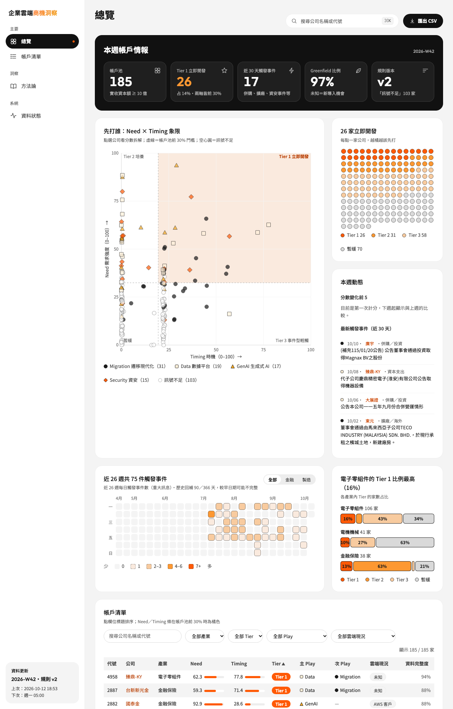
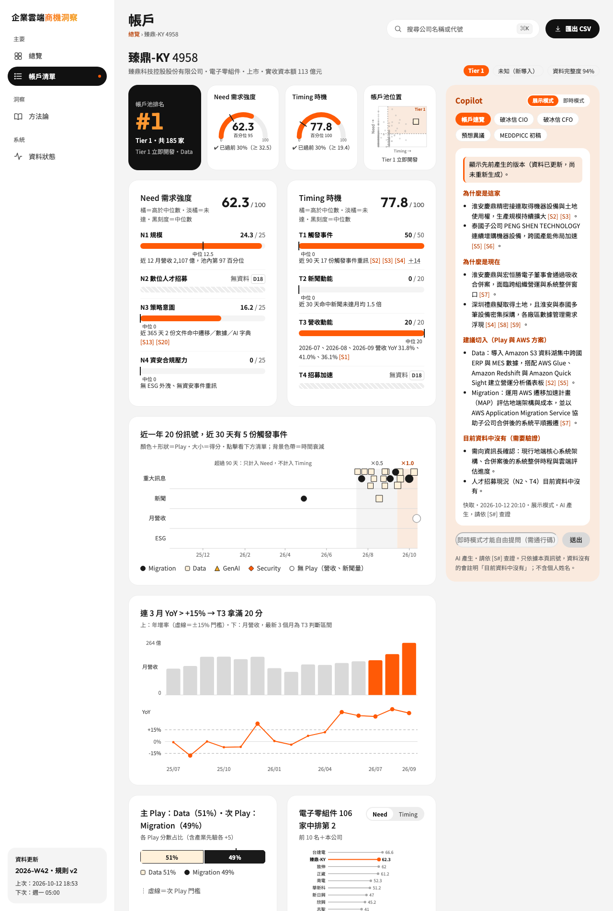
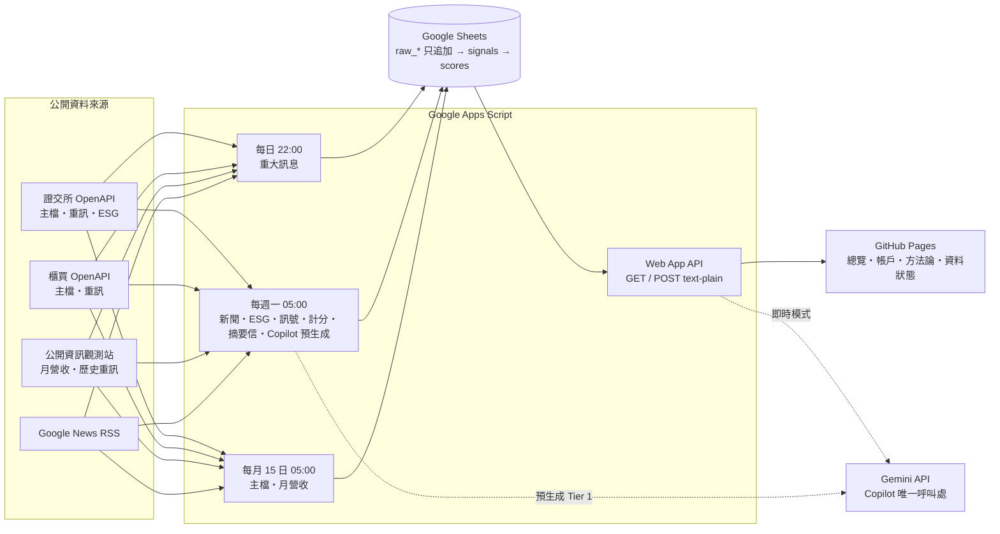
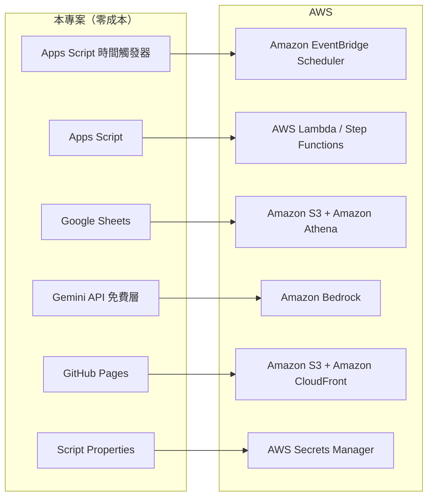

# 企業雲端商機洞察平台（CloudLens）

> 以公開資料為台灣上市櫃企業打分數、標出切入劇本（Play），協助 AWS 業務決定「先打誰、拿什麼去談」；再用 AI 產出帳戶速覽、破冰信與 MEDDPICC 草稿。

**線上展示**：<https://lindasu1021-work.github.io/cloudlens/>｜**零成本**：Google Apps Script ＋ Google Sheets ＋ GitHub Pages ＋ Gemini 免費層

| 總覽 | 帳戶頁 |
|---|---|
|  |  |

## 它解決什麼問題

業務面對上百家目標企業，缺少「先打誰」的依據。本專案用**可追溯的公開訊號**回答三件事：

1. **有沒有需求（Need）**：規模、策略意圖、資安合規壓力
2. **是不是現在（Timing）**：重大訊息觸發事件、新聞動能、營收動能
3. **拿什麼去談（Play）**：Migration／Data／GenAI／Security，並對應 AWS 服務

每一分都對得到一則公開訊號（[S#] 編號、可點開原文）；缺資料不算 0 分，而是移出分母並顯示資料完整度。

## 成果指標（不宣稱回覆率）

| 指標 | 狀態 |
|---|---|
| 評分驗證 precision@20%（公開來源證實使用公有雲的帳戶池公司，落在 Need 前 20% 的比例） | **100%（5/5）**，但「只看營收規模」的基準線同樣 5/5，**尚無法證明優於挑最大的公司**；方法論頁完整揭露 |
| 調研時間實測（手動研究 3 家 vs 系統，各自計時） | 待實測 |

## 架構



### 正式上線版在 AWS 上的對應



## 評分規則（目前 v2）

| 軸 | 項目 | 滿分 | 狀態 |
|---|---|---|---|
| Need | N1 規模（營收百分位） | 25 | ✅ |
|  | N2 數位人才招募 | 25 | ⏸ 停用（就業通資料僅 1,000 筆且集中台北市，D18） |
|  | N3 策略意圖（重訊＋新聞命中字典） | 25 | ✅ |
|  | N4 資安合規壓力 | 25 | ✅（上櫃無 ESG 揭露，D19） |
| Timing | T1 觸發事件 | 50 | ✅ |
|  | T2 新聞動能 | 20 | ✅ |
|  | T3 營收動能 | 20 | ✅（金融保險業不適用，D27） |
|  | T4 招募加速 | 10 | ⏸ 停用（D18） |

遞減報酬 `滿分 × (1 − 0.5ⁿ)`、時間衰減（30 天內 ×1、31–90 天 ×0.5、其後不計）、Tier＝各軸帳戶池前 30%。
規則 v2：Play 分數只來自產業先驗者標「**訊號不足**」，不再預設 Migration。
完整規則與驗證見網站「方法論」頁、`docs/00_決策紀錄.md`（D1–D40）。

## Repo 結構

```
docs/     規格書（spec.md）、決策紀錄（00）、各階段結果（phase*_results.md）、UI 需求（05、06）、截圖
gas/      Apps Script 原始碼（以 clasp 同步）
web/      GitHub Pages 靜態前端（tokens.css 為唯一色票來源）
.github/  GitHub Pages 部署流程
```

## 從零開始設定

> 全程免費。預計 30–40 分鐘。細節見 [docs/phase0_setup.md](docs/phase0_setup.md)。

1. **建立資料庫**：到 <https://sheets.new> 建立試算表，記下網址中的 ID。
2. **部署後端**：
   ```bash
   npm install -g @google/clasp
   clasp login                       # 先到 script.google.com/home/usersettings 開啟 Apps Script API
   cd gas
   clasp create --type sheets --title "企業雲端商機洞察平台" --rootDir .
   clasp push --force
   ```
3. **設定指令碼屬性**（Apps Script 專案設定 → 指令碼屬性，**不要寫進程式碼或 repo**）：

   | 屬性 | 說明 |
   |---|---|
   | `SHEET_ID` | 步驟 1 的試算表 ID |
   | `GEMINI_API_KEY` | <https://aistudio.google.com/apikey> |
   | `ALERT_EMAIL` | 失敗告警與每週摘要的收件信箱 |
   | `LIVE_PASSCODE` | Copilot 即時模式通行碼（自訂） |
   | `GEMINI_MODEL`（選填） | 模型候選，逗號分隔；預設見 `config_settings.gemini_model` |

4. **初始化**：在 Apps Script 編輯器依序執行 `setupPhase1`、`setupPhase2`（建表、匯入字典、安裝排程；背景回補資料約 1–2 小時，會自動接續）。
5. **部署 Web App**：部署 → 新增部署作業 → 網頁應用程式（執行身分：我；存取：所有人），複製 `/exec` 網址貼進 `web/js/api.js` 的 `GAS_URL`。
6. **發布網站**：repo 設為公開，Settings → Pages → Source 選 **GitHub Actions**；推送 `web/` 即自動部署。

## 日常維運

| 想做的事 | 做法 |
|---|---|
| 手動跑某個排程 | Apps Script 編輯器選 `dailyJob`／`weeklyJob`／`monthlyJob` → 執行（超過 4.5 分鐘會存斷點，1 分鐘後自動接續） |
| 改了字典或權重後立刻重算 | 執行 `rescoreNow`（不重抓資料，約 1 分鐘）；字典與權重放在 Sheets 的 `config_keywords`、`config_weights` |
| 立刻預生成 Copilot（3 家） | 開啟 `copilot.gs` → 執行 `copilotPrecomputeNow` |
| 看排程跑得如何 | 網站「資料狀態」頁；或 Sheets 的 `run_log`（每個步驟一列）、`ai_log`、`mail_log` |
| 調整帳戶池門檻 | 改 `config_settings.capital_threshold` → 執行 `recomputeUniverse` 再 `rescoreNow` |
| 新增 AWS 客戶／公有雲客戶（驗證集） | 在 `config_validation` 加一列（`stock_code`、`cloud`＝aws／azure／gcp、`evidence_url`） |
| **停用所有排程** | 執行 `removeAllTriggers`，或到 Apps Script 左側「觸發條件」逐一刪除 |
| 重新啟用排程 | 執行 `installTriggers` |

排程時間（台灣時區）：每日 22:00–23:00、每週一 05:00–06:00、每月 15 日 05:00–06:00。**每日排程會自動重試**上次失敗的步驟。

## 常見錯誤

| 現象 | 原因與處理 |
|---|---|
| `Apps Script API has not been enabled` | 到 <https://script.google.com/home/usersettings> 開啟，等幾分鐘 |
| Web App 回「存取遭拒」 | 部署的「誰可以存取」要選「所有人」；網址要用 `/exec` 且部署後重新授權一次 |
| 網站顯示「靜態快照」 | GAS 連不上或逾時；稍後重新整理。頁首更新卡會標示 |
| 資料狀態頁某來源「失敗」 | 多為政府網站單次回應異常；每日排程會自動重試，仍失敗再看 `run_log.error` |
| Copilot「額度已用完」 | Gemini 免費層每日／每分鐘上限；展示模式會顯示先前產生的版本，隔日恢復 |
| `Exceeded maximum execution time` | 單次執行超過 6 分鐘；系統已分批存斷點，重跑同一函式即可接續 |
| 新版字典沒生效 | 執行 `rescoreNow`；網站資料快取 6 小時（計分完成時會清除） |

## 資料來源與限制

| 來源 | 用途 | 頻率 |
|---|---|---|
| 臺灣證券交易所 OpenAPI | 上市公司主檔、重大訊息、ESG 資訊安全 | 每月／每日／每週 |
| 證券櫃檯買賣中心 OpenAPI | 上櫃公司主檔、重大訊息 | 每月／每日 |
| 公開資訊觀測站（MOPS） | 月營收、歷史重大訊息 | 每月／每週回補 |
| Google News RSS | 新聞動能與策略意圖 | 每週 |
| 公開雲端廠商案例（人工整理） | 驗證集與雲端現況 | 每季檢查 |

**限制（誠實揭露）**：就業通資料不足而停用招募訊號；上櫃公司無 ESG 揭露；重大訊息歷史每週回補 90 天（約一個月補滿一年，期間「訊號不足」偏多）；新聞每次查詢上限約 100 則且轉載會重複；雲端現況多為「未知」；驗證集小且偏金控。不蒐集任何個人姓名或聯絡方式。

## 預估成本

| 項目 | 費用 |
|---|---|
| Google Apps Script（觸發器每日 90 分鐘額度，實際約 30–60 分鐘） | 0 |
| Google Sheets | 0 |
| GitHub Pages（公開 repo） | 0 |
| Gemini API 免費層（展示模式只讀快取；即時模式每日上限預設 30 次） | 0 |
| **合計** | **0** |

## 安全與隱私

- 金鑰、通行碼、Email、Sheets ID 只存在 Apps Script 指令碼屬性，repo 與前端都沒有。
- API 只回傳由公開資料計算的結果；通行碼只存在瀏覽器分頁的 sessionStorage。
- Copilot 規則：每個論點標 [S#]、資料沒有就說「目前資料中沒有」、不出現人名。

## 開發過程

本專案依 `docs/spec.md` 分 Phase 0–5 施工，每個決策都記錄在 `docs/00_決策紀錄.md`，各階段的驗證結果在 `docs/phase*_results.md`，Git 歷史本身即為過程紀錄。
